# LabEntry

**Ứng dụng quản lý kết quả xét nghiệm thủ công cho phòng xét nghiệm** — tiếp nhận mẫu bằng quét mã vạch, nhập và phát hành kết quả, đóng dấu kỹ thuật viên có mã PIN bảo vệ, và in bảng kết quả tùy biến hoàn toàn. Chạy ngay trên điện thoại, không cần máy chủ, dữ liệu lưu tại máy.

**Manual lab test results manager for small laboratories** — barcode sample intake, result entry and release, PIN-protected technician stamps, and fully customizable printable result sheets. Runs right on a phone, no server needed, data stays on the device.

🔗 **Dùng thử / Live demo:** https://nguyentruongcongminh.github.io/lab-entry-app/

📥 **Tải ứng dụng / Download the app:**

- 🤖 **Android (APK):** [**Tải LabEntry cho Android (v1.0.0-trial5)**](https://github.com/nguyentruongcongminh/lab-entry-app/releases/download/android-v1.0.0-trial5/LabEntry-trial5.apk) — bản chạy trực tiếp trên điện thoại Android (6.0 trở lên, ~3,3 MB): ruột ứng dụng luôn là bản mới nhất như bản web, thêm **báo thức hệ thống kêu + rung đúng giờ nhập kết quả ngay cả khi app đã đóng**, quét mã vạch bằng camera ngay trong app, **sao lưu ghi thẳng vào thư mục Tải xuống** và **in / xuất PDF qua hộp thoại in của hệ thống**. Cài đặt: mở file APK, cho phép cài ứng dụng từ tệp/trình duyệt khi máy hỏi. · *Native Android app: always-current web core, plus OS-level due-time alarms that ring and vibrate even when the app is fully closed, in-app barcode scanning, backups written straight to the Downloads folder, and printing / PDF export through the system print dialog.*
- 🍎 **iOS:** đang thử nghiệm — link tải sẽ cập nhật sau. · *iOS: in testing — download link coming soon.*
- 🌐 **Bản web / Web version:** dùng ngay tại link demo ở trên, không cần cài đặt. · *Runs instantly in the browser via the demo link above.*

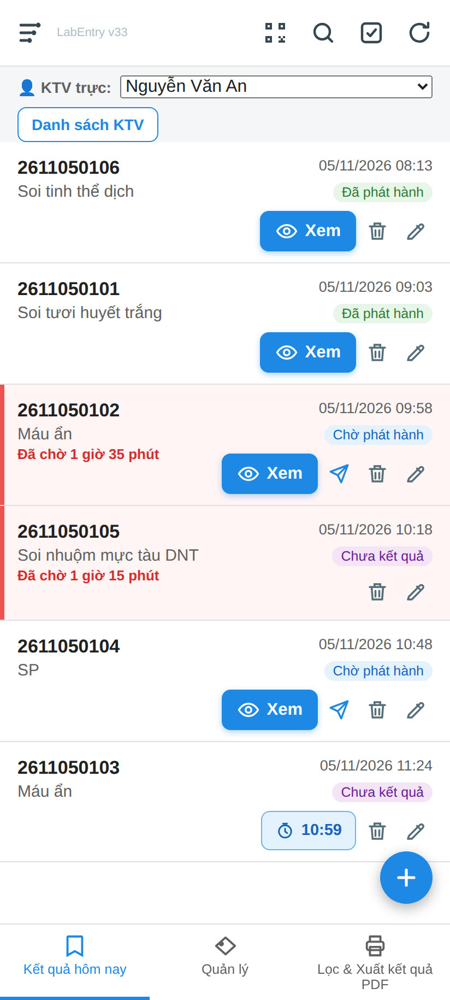

| | |
|---|---|
| 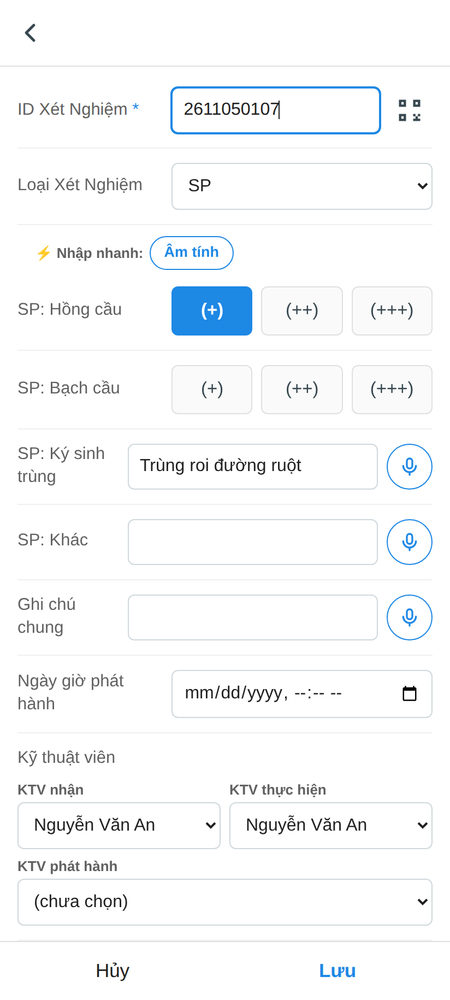 | 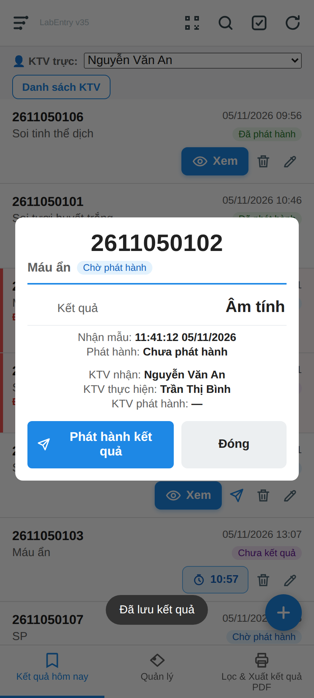 |
| *Form nhập kết quả với các trường theo từng loại xét nghiệm · Result entry form with per-test fields* | *Màn hình "Xem" chữ lớn để chép kết quả vào máy xét nghiệm · Large-print summary view for transcribing results* |
| 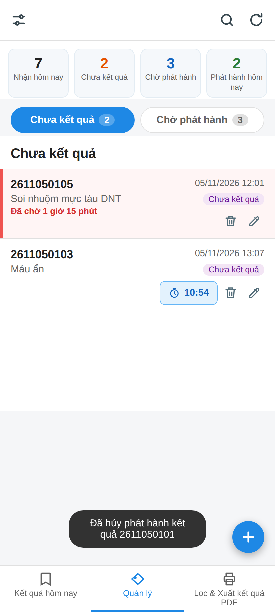 | 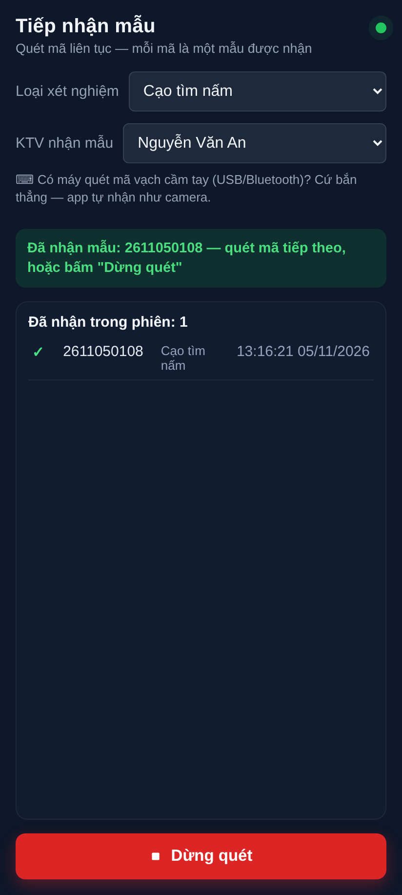 |
| *Quản lý: thống kê, mẫu chờ quá 60 phút tô đỏ · Manage: stats bar, overdue samples highlighted* | *Quét tiếp nhận liên tục bằng camera · Continuous barcode intake scanning* |
| 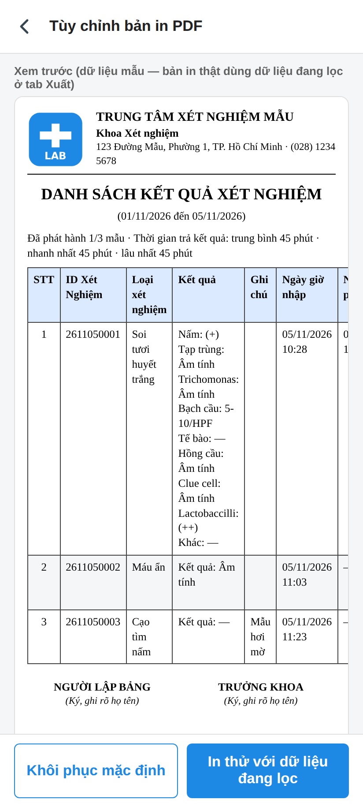 | 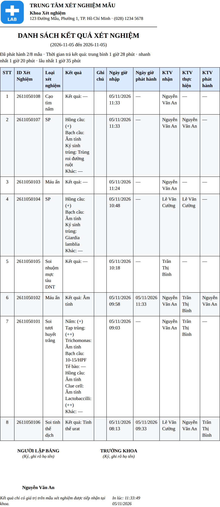 |
| *Tùy chỉnh bố cục bản in, xem trước trực tiếp · Print layout studio with live preview* | *Tờ kết quả in ra · The printed result sheet* |
| 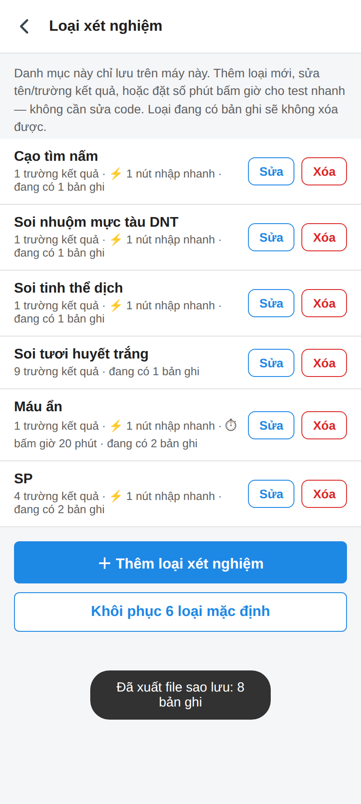 | |
| *Danh mục loại xét nghiệm tự sửa được · User-editable test catalogue* | |
| 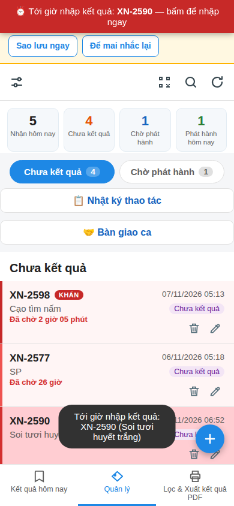 | 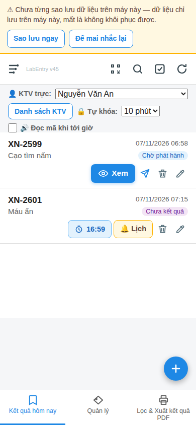 |
| *Banner đỏ báo mẫu tới giờ nhập kết quả, mẫu KHẨN gắn nhãn đỏ · Red banner for samples due for result entry, STAT sample flagged in red* | *Nút 🔔 Lịch cạnh đồng hồ đếm ngược, chỉ trên điện thoại · 🔔 Calendar button next to the countdown, mobile only* |
| 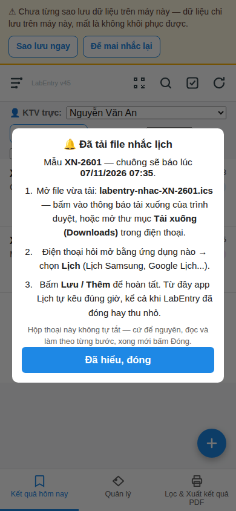 | 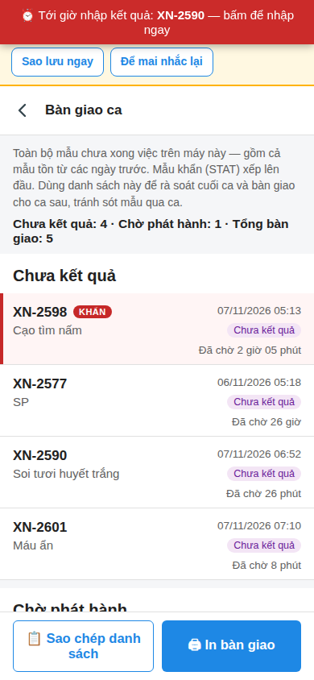 |
| *Hộp thoại hướng dẫn cài nhắc Lịch, không tự tắt · Persistent calendar-reminder setup guide* | *Bàn giao ca: mọi mẫu chưa xong, kể cả tồn từ ngày trước · Shift handover: every unfinished sample, including previous days' leftovers* |
| 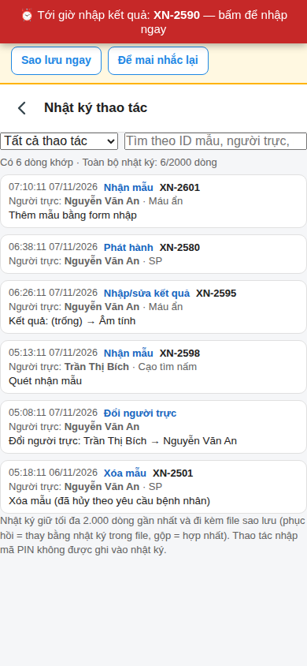 | |
| *Nhật ký thao tác: ai làm gì, lúc nào · Audit log: who did what, when* | |
| 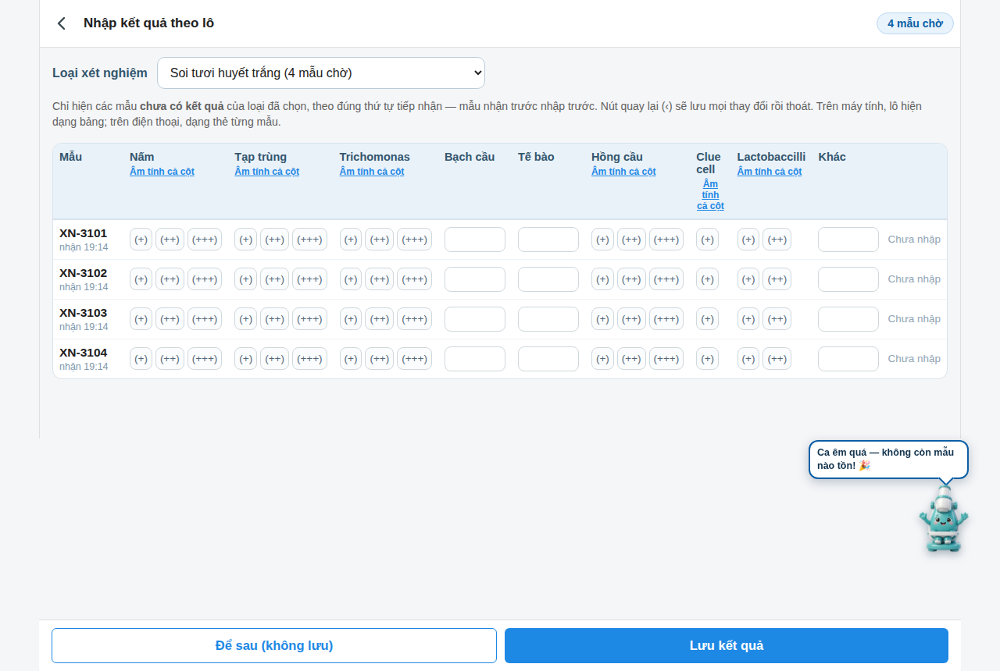 | 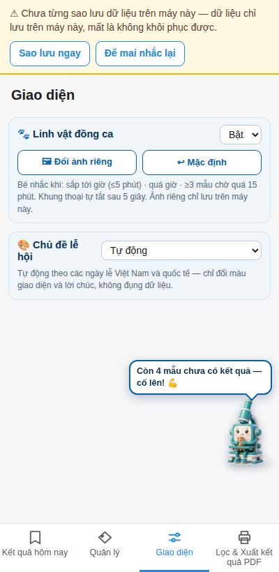 |
| *Nhập theo lô: dạng bảng trên máy tính, dạng thẻ trên điện thoại, đúng thứ tự tiếp nhận · Batch entry: grid on desktop, cards on phone, strict intake order* | *Tab Giao diện: linh vật đồng ca và chủ đề lễ hội · Display tab: shift mascot and holiday themes* |
| 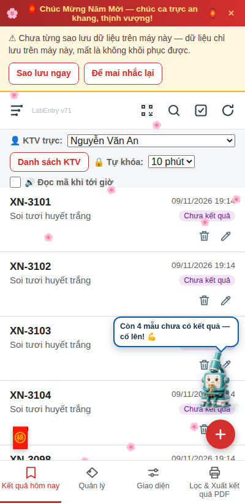 | 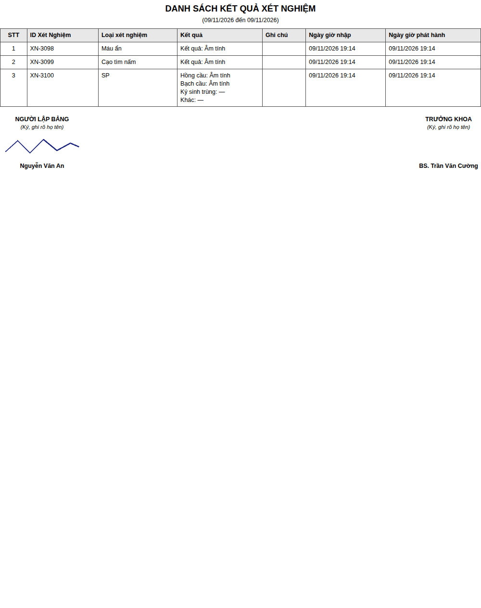 |
| *Chủ đề Tết: banner chúc, hoa đào rơi, nhạc lễ hội · Tết theme: greeting banner, falling blossoms, festive music* | *Phiếu in có ảnh chữ ký của từng KTV, mỗi ô ký một vị trí riêng · Printed sheet with each technician's signature image, each block positioned independently* |
| 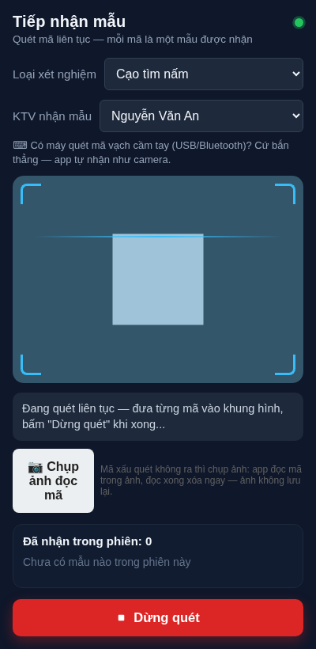 | |
| *Chụp ảnh đọc mã khi mã in xấu quét không ra — ảnh đọc xong xóa ngay, không lưu · Photo barcode capture for poor-quality codes — the image is discarded after decoding, never stored* | |

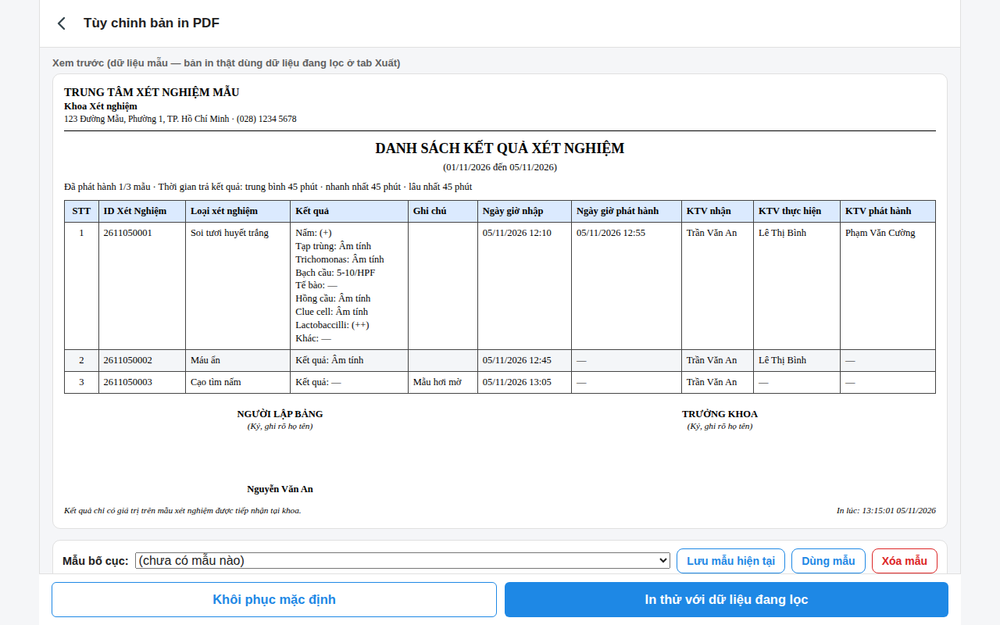
*Trên máy tính: khung rộng, trang tùy chỉnh in hiện đủ mọi cột của tờ kết quả · On desktop: wide layout, the print studio shows the full result sheet*

## Tính năng chính / Key features

- **Tiếp nhận mẫu bằng mã vạch** — quét liên tục bằng camera điện thoại, hỗ trợ máy quét mã vạch cầm tay (kiểu bàn phím), hoặc nhập tay. Chặn trùng mã + trùng loại xét nghiệm. · *Barcode intake — continuous camera scanning, handheld wedge scanners, or manual entry. Duplicate sample + test-type combinations are blocked.*
- **Theo dõi 3 trạng thái rõ ràng** — Chưa kết quả / Chờ phát hành / Đã phát hành; danh sách mẫu chờ quá 60 phút tự tô đỏ kèm thời gian chờ; các xét nghiệm hẹn giờ có đồng hồ đếm ngược từng mẫu và báo chuông khi tới giờ nhập kết quả — báo động lặp lại mỗi 15 giây trong 15 phút đầu quá giờ, kèm banner đỏ cố định, thông báo hệ thống và giữ màn hình sáng trong lúc đếm. Phát hành ngay không cần bấm xác nhận, và có thể **hủy phát hành** để sửa lại khi cần. · *Three clear statuses, overdue highlighting after 60 minutes, and per-sample countdown timers for timed tests with a repeating audible alert when the result-entry time comes, a persistent red banner, system notifications and a screen wake lock while counting. Release is instant with no confirmation dialog, and a release can be undone when a correction is needed.*
- **Nhập kết quả nhanh** — trường nhập thay đổi theo từng loại xét nghiệm, nút nhập nhanh tự định nghĩa (một chạm điền sẵn bộ kết quả thường gặp), nhập bằng giọng nói tiếng Việt. · *Fast result entry — dynamic per-test fields, user-defined one-tap quick-result buttons, Vietnamese voice input.*
- **Nhập kết quả theo lô** — nhập một lần cho nhiều mẫu cùng loại đang chờ: dạng bảng trên máy tính (có nút Âm tính cả cột), dạng thẻ từng mẫu trên điện thoại, luôn theo đúng thứ tự tiếp nhận — mẫu nhận trước nhập trước. · *Batch result entry — enter results for many pending samples of one type at once: a grid on desktop (with per-column all-negative shortcuts), one card per sample on phone, always in strict intake order.*
- **Chụp ảnh đọc mã** — mã vạch in xấu, quét trực tiếp mãi không ra thì chụp ảnh tem mẫu: ứng dụng đọc mã ngay trên ảnh chụp (thử toàn ảnh, chưa ra thì thử vùng giữa ảnh) rồi tiếp nhận như quét thường. Ảnh chỉ xử lý trong bộ nhớ rồi **xóa ngay — không lưu lại ở đâu**. · *Photo barcode capture — when a printed code is too poor for live scanning, photograph the label: the app decodes the code from the still image (full frame first, then the centre crop) and intakes it like a normal scan. The photo is processed in memory and **discarded immediately — never stored anywhere**.*
- **Đóng dấu kỹ thuật viên có mã PIN** — mỗi mẫu tự ghi tên KTV nhận / thực hiện / phát hành theo người đang trực. Đổi người trực **phải nhập đúng mã PIN 6 ký tự** của người đó; PIN chỉ được lưu dạng **băm SHA-256 kèm muối** nên kể cả trong file sao lưu cũng không ai đọc được PIN gốc, mang sang máy khác vẫn dùng PIN cũ bình thường. · *Technician stamps with PIN protection — every sample records who received / performed / released it. Switching the on-duty technician requires that person's 6-character PIN; PINs are stored only as salted SHA-256 hashes, so backups never expose them while still working on other devices.*
- **Cổng người trực & nhật ký thao tác** — chưa chọn KTV trực thì không thể tiếp nhận, lưu, phát hành hay xóa mẫu, tránh thao tác không rõ người làm. Mọi thao tác quan trọng đều được ghi nhật ký: nhận mẫu, sửa kết quả (kèm giá trị cũ → mới), phát hành/hủy phát hành, xóa mẫu, đổi người trực, sao lưu/phục hồi; nhật ký đi theo file sao lưu và xem được ngay trong ứng dụng — riêng mã PIN không bao giờ được ghi vào nhật ký. · *On-duty gate & audit log — with no technician on duty, intake, saving, releasing and deleting are blocked. Key actions are logged (sample receipt, result edits with old → new values, release/un-release, deletions, operator changes, backup/restore); the log travels with the backup file and is viewable in-app — PINs are never logged.*
- **Hỗ trợ ca trực** — nhắc sao lưu khi đã quá 3 ngày chưa sao lưu; trang **Bàn giao ca** liệt kê toàn bộ mẫu chưa xong (kể cả tồn từ ngày trước) để in hoặc sao chép; gắn cờ **KHẨN** cho mẫu ưu tiên (nhãn đỏ nổi bật trong danh sách và trên phiếu in; mọi danh sách luôn xếp theo thứ tự tiếp nhận); tự khóa người trực sau vài phút không thao tác; tùy chọn **đọc to** mã mẫu khi tới giờ; và **quét mã để tìm mẫu** ngay trong tab Quản lý. · *Shift-work support — a backup reminder after 3 days without one, a handover page listing every unfinished sample (including previous days' leftovers) to print or copy, a STAT urgent flag with a red highlight in lists and on printouts (every list always follows intake order), operator auto-lock after inactivity, optional spoken due-sample alerts, and scan-to-find in the Manage tab.*
- **Nhắc tới giờ qua Lịch điện thoại (chỉ trên điện thoại)** — cạnh đồng hồ đang đếm có nút **🔔 Lịch**: bấm để tải một file lịch (.ics), thêm vào Lịch của máy là chuông sẽ kêu đúng giờ phải nhập kết quả **kể cả khi ứng dụng đã đóng hay thu nhỏ**, kèm hộp thoại hướng dẫn từng bước không tự tắt. Trên máy tính nút này không hiện — không cần, vì cửa sổ ứng dụng luôn mở. Nhận mẫu mới xong, ứng dụng tự chuyển sang tab Quản lý — khung Chưa kết quả để xử lý tiếp hàng chờ. · *Phone-calendar due reminders (mobile only) — a 🔔 button next to a running countdown downloads a calendar file (.ics); add it to the phone's Calendar and it rings exactly at the due time even with the app closed or minimised, with a persistent step-by-step setup guide. The button is hidden on desktop, where it isn't needed. After new samples are received, the app automatically switches to the Manage tab's no-result panel.*
- **Bản in tùy biến sâu** — logo, đầu trang cơ quan, 12 cột bật/tắt–đổi tên–kéo thứ tự, tách cột Kết quả thành từng cột riêng theo trường, nhóm theo ngày/loại, mẫu bố cục lưu sẵn, khổ A4/A5 ngang/dọc. Khối chữ ký cuối phiếu gắn **ảnh chữ ký của từng KTV** (vẽ tay trong ứng dụng hoặc tải ảnh lên, đi theo file sao lưu), mỗi khối tự chọn vị trí trái/giữa/phải độc lập và không bị tách đôi qua trang. Đầu trang 3 vùng: khối đơn vị ở giữa, vùng bên phải là khối kiểm soát tài liệu (mã tài liệu, lần ban hành, ngày hiệu lực...) kèm **mã vạch Code128** của mã tài liệu, hoặc một ảnh thứ hai (logo/con dấu). Xuất thêm CSV kèm thống kê thời gian trả kết quả (TAT). · *Deeply customizable printouts — logo, letterhead, 12 toggleable/renamable/reorderable columns, split result columns, grouping, saved presets, A4/A5 portrait/landscape. Footer signature blocks carry **each technician's own signature image** (drawn in-app or uploaded, travels with backups), each block positioned left/center/right independently and kept whole across page breaks. Three-zone header: a centred organisation block, and a right zone holding a document-control box (document code, revision, effective date...) with a **Code128 barcode** of the document code, or a second image (logo/stamp). CSV export with turnaround-time stats.*
- **Sao lưu trọn gói & gộp dữ liệu** — một file sao lưu mang theo mẫu, danh mục, danh sách KTV (kèm băm PIN), bố cục in và thư viện mẫu in; phục hồi nguyên trạng hoặc **gộp** thêm phần chưa có khi chuyển dữ liệu giữa các máy. Khi **phục hồi**, KTV trực tự đặt về "chưa chọn" để người dùng máy tự chọn lại ca trực (nhập PIN); khi **gộp**, máy giữ nguyên người đang trực. · *Full-package backup & merge — one backup file carries samples, catalogue, staff list (with PIN hashes), print layout and presets; restore wholesale or merge only what's missing when moving data between devices. Restoring resets the on-duty technician to none so the shift is picked again (with PIN); merging keeps the device's current operator.*
- **Linh vật ca trực & chủ đề lễ hội** — tab **Giao diện** riêng: linh vật nhắc việc theo tình trạng ca (sắp tới giờ, quá giờ, tồn nhiều mẫu chờ lâu, kết quả chờ phát hành quá 60 phút), đổi được ảnh riêng trên từng máy; 11 chủ đề lễ hội Việt Nam & quốc tế tự bật theo ngày (Tết, Trung Thu, Giáng Sinh, 27/2, 8/3, Giỗ Tổ, 30/4, 1/5, 20/10, 20/11, 22/12) kèm trang trí, hoa/tuyết rơi và nhạc lễ hội ngắn — chỉ đổi giao diện, không đụng dữ liệu. · *Shift mascot & holiday themes — a dedicated Display tab: a mascot that reacts to the shift state (due soon, overdue, backlogged), with a per-device custom image option; 11 Vietnamese & international holiday themes that switch on automatically (decorations, falling petals/snow, short festive tunes) — appearance only, data untouched.*
- **Cài đặt như ứng dụng, chạy không cần mạng, dùng tốt cả trên máy tính** — thêm vào màn hình chính điện thoại và dùng offline; trên máy tính ứng dụng tự mở khung rộng (trang tùy chỉnh bản in hiện đủ mọi cột, dễ đọc). Danh mục loại xét nghiệm tự thêm/sửa được ngay trong ứng dụng. · *Installable (PWA), offline-capable, and desktop-friendly — on a computer the layout widens automatically (the print studio shows the full sheet, every column readable). The test catalogue is editable in-app.*

## Cập nhật gần đây / Recent updates

- **Android (APK) v1.0.0-trial3** — **Có bản Android chính thức** (xem mục Tải ứng dụng ở đầu trang): báo thức tới giờ do hệ điều hành phụ trách — kêu + rung ngay cả khi app đã đóng hẳn, quét mã vạch bằng camera trong app. · *Official Android app: OS-level due-time alarms (ring + vibrate even when fully closed) and in-app camera scanning.*
- **v81** — **Giờ Thực hiện XN trên sổ = giờ nhập đầu vào**: cột giờ "Thực hiện XN" nay lấy giờ nhận mẫu (lúc nhập xét nghiệm đầu vào), "Đọc kết quả" lấy giờ lưu kết quả, "Nhập kết quả" lấy giờ phát hành — mẫu cũ chưa có giờ lưu vẫn có giờ thực hiện. · *The ledger's Perform-stage time is now the intake time; Read = result-saved time; Enter = release time.*
- **v80** — **Giờ đọc kết quả trên Sổ theo dõi**: giờ lưu kết quả nay in ở cả hai cột Giờ "Thực hiện XN" và "Đọc kết quả" (soi và đọc là một công đoạn tại kính). · *The result-saved time now prints in both the Perform and Read stage time columns of the tracking ledger.*
- **v79** — **Sửa lỗi canh giữa dòng Khoa trên phiếu Sổ theo dõi**: bản v77 gắn lớp canh giữa nhưng quy tắc CSS chỉ áp cho ô bảng nên dòng Khoa chưa canh giữa thật; nay đã sửa và kiểm chứng bằng vị trí chữ thật trên tờ in. · *Fixed the department-line centering on the ledger sheet (the v77 CSS rule missed the header element).*
- **v78** — **Trang Xem hiện giờ có kết quả**: dòng "Có kết quả" (giờ lưu kết quả) nằm giữa Nhận mẫu và Phát hành trong trang chi tiết mẫu. · *The sample summary view now shows the result-saved time between receipt and release.*
- **v77** — **Hoàn thiện phiếu Sổ theo dõi + sửa tràn màn hình tùy chỉnh in**: cột in "Ngày giờ có kết quả" cho phiếu danh sách; đầu sổ có thêm tùy chọn canh giữa dòng Khoa/Phòng theo tên đơn vị và gom dòng Bộ phận/Ngày vào giữa như form mẫu; trang Tùy chỉnh bản in không còn tràn ngang trên điện thoại. · *Ledger-header centering options matching the hospital form, a result-time column for the list sheet, and a print-settings screen that fits phone widths.*
- **v76** — **Giờ lưu kết quả + phiếu Sổ theo dõi thủ công + file mẫu bố cục in**: mỗi mẫu nay ghi thêm ngày giờ lưu kết quả (giờ thực hiện xét nghiệm); trang Tùy chỉnh bản in có thêm kiểu phiếu "Sổ theo dõi" dạng sổ giấy BM04 — mỗi chỉ số một dòng, ba giai đoạn Thực hiện / Đọc / Nhập kết quả lấy giờ và người từ dữ liệu trong app, cột NV kiểm tra để trống cho ghi tay, mỗi ngày một tờ. Cài đặt in xuất/nhập được thành file mẫu riêng (chỉ chứa bố cục, không chứa dữ liệu mẫu) để mang bố cục giữa các máy. · *Result-saved timestamp, a BM04-style manual tracking-ledger printout (one row per result field, three workflow stages, blank checker columns for handwriting, one day per page), and print-layout template files that carry settings only.*
- **v75** — **Linh vật báo hẹn lại xong là về bình thường**: báo cáo mẫu hẹn lại đầu ngày hiện đúng một lần (5 giây), xong linh vật quay về tư thế "Hết mẫu rồi!" và không còn huy hiệu đỏ đếm số mẫu tồn trên đầu. · *After its single start-of-day deferred-samples report, the mascot returns to its normal all-clear pose with no lingering count badge.*
- **v74** — **Gọn tab Quản lý + nút hẹn lại trên dòng mẫu**: bốn nút chức năng của tab Quản lý xếp lưới 2 cột thay vì nằm dọc chiếm chỗ; giới thiệu trang Mẫu hẹn lại rút ngắn; thêm nút ⏸ hẹn lại ngay trên từng dòng mẫu (bản v73 nút chỉ ở trong trang Xem, mẫu chưa có kết quả không mở Xem được nên khó tìm). · *Compact 2-column action grid on the Manage tab, a shorter deferred-page intro, and a per-row defer button.*
- **v73** — **Mẫu hẹn lại / ngoại lệ**: mẫu hụt, mẫu không đạt phải lấy lại, hoặc hẹn lại hôm sau vì lý do riêng được đánh dấu hẹn lại (chọn lý do ở trang Xem) — không còn tính là chưa kết quả / chưa phát hành, không báo động, nằm ở trang riêng "Mẫu hẹn lại" để xử lý và bàn giao riêng (chọn một số mẫu hoặc tất cả); linh vật chỉ báo cáo nhóm này một lần vào đầu ngày. · *Deferred/exception samples (insufficient, failed–recollect, rescheduled) are marked with a reason, leave every pending queue and alarm, live on their own page with separate handover, and are reported by the mascot once at the start of each day.*
- **v72** — **Linh vật báo mẫu chưa phát hành**: mẫu đã có kết quả mà quá 60 phút từ lúc nhận vẫn chưa phát hành thì linh vật nhắc riêng (nêu ID, đếm số mẫu); lời thoại lúc hết mẫu đổi thành "Hết mẫu rồi!". · *The shift mascot now flags samples whose results have been waiting over 60 minutes for release, and its all-clear line is shorter.*
- **v71** — **Chụp ảnh đọc mã + khối ký không tách trang**: mã vạch in xấu quét trực tiếp không ra thì bấm **📷 Chụp ảnh đọc mã** ngay trong màn hình quét — app đọc mã từ ảnh chụp (ảnh đọc xong xóa ngay, không lưu lại); khối chữ ký cuối phiếu không còn bị tách đôi qua hai trang khi in. · *Photo barcode capture in the scanner (image is discarded right after decoding, never stored); the signature block no longer splits across printed pages.*
- **v70** — **Sửa lỗi vị trí ô ký**: ô ký chọn Phải/Trái nay nằm đúng vị trí bất kể thứ tự sắp xếp các ô; dòng '(Ký, ghi rõ họ tên)' và họ tên người ký luôn canh giữa trong ô. · *Signature blocks now land in their chosen position regardless of block order; the note and signer name stay centered in each block.*
- **v69** — **Mỗi ô ký một vị trí riêng**: từng ô chữ ký cuối phiếu (Trưởng khoa, Người lập bảng, người phát hành…) tự chọn nằm **Trái / Giữa / Phải** độc lập với nhau — ví dụ Trưởng khoa ký bên trái, KTV ký bên phải trên cùng một phiếu. · *Each signature block picks its own left/center/right position independently.*
- **v68** — **Chỉnh vị trí khối chữ ký cuối phiếu**: trong Cấu hình bản in, chọn khối chữ ký (người lập bảng, người phát hành…) nằm **Trái / Giữa / Phải** tùy mẫu phiếu của khoa. · *Position the report's signature block left, center or right.*
- **v67** — **Chữ ký của từng KTV trên bản in**: mỗi KTV lưu một ảnh chữ ký (vẽ trực tiếp trong app hoặc tải ảnh lên); gắn chữ ký cho từng ô ký trong cấu hình bản in là phiếu in ra đã có sẵn chữ ký, khỏi ký tay từng tờ. · *Each technician can store a signature image (drawn in-app or uploaded) and attach it to the report's signature blocks.*
- **v66** — **Bàn phím không còn che ô nhập**: trên Android, chạm vào ô nhập là app tự cuộn ô vào giữa vùng nhìn thấy phía trên bàn phím, đồng thời ẩn linh vật/thanh điều hướng cho thoáng khi đang gõ — áp dụng cho cả form thường và nhập theo lô. · *The on-screen keyboard no longer covers the field you are typing in, in both single and batch entry.*
- **v65** — **Nhập lô mượt hơn + linh vật bớt lặp**: ở dạng thẻ, lưu xong chuyển sang mẫu tiếp theo là app tự cuộn lên đầu và đưa mã mẫu đang nhập ra giữa dải ID; bong bóng của linh vật giãn nhịp — cùng một câu nói chỉ lặp lại sau 3 phút và việc số phút đếm ngược thay đổi không còn làm bong bóng bật lại liên tục. · *Batch card mode auto-scrolls to the next sample; the mascot repeats itself far less often.*
- **v64** — **Nhạc lễ hội + sửa hoa/tuyết rơi**: Tết, Giáng Sinh, Trung Thu có giai điệu đệm ~10 giây phát khi lời chúc hiện (soạn bằng WebAudio, không cần file nhạc, tự tắt nhỏ dần); vật rơi (hoa đào, tuyết…) nay rải đều khắp chiều ngang màn hình thay vì dồn về phía phải. · *Holiday tunes (~10 s, synthesized in-app) for Tết, Christmas and Mid-Autumn, and falling decorations now spread across the whole screen width.*
- **v63** — **Tắt lời chúc chỉ là tạm thời**: bấm ✕ ẩn lời chúc của dịp lễ đang xem; chuyển sang dịp khác rồi quay lại (hoặc mở lại app) là lời chúc hiện tiếp, đúng thói quen xem từng event. · *Dismissing a holiday greeting is temporary — switch away and back, or reopen the app, and it shows again.*
- **v62** — **Ghi nhớ tắt lời chúc theo từng chủ đề**: chủ đề nào đã tắt lời chúc thì cả ngày hôm đó quay lại vẫn ẩn; tắt thêm chủ đề khác không làm hiện lại chủ đề đã tắt. · *Greeting dismissal is now remembered per theme for the whole day.*
- **v61** — **Trang trí riêng cho từng dịp lễ + sửa lỗi lời chúc**: mỗi chủ đề có trang trí riêng (hoa đào rơi dịp Tết, tuyết rơi và người tuyết dịp Giáng Sinh, thỏ ngọc Trung Thu, bao lì xì… ở góc màn hình và hai đầu dải chúc); tắt lời chúc của một chủ đề không còn làm mất lời chúc của các chủ đề khác trong cùng ngày. · *Per-holiday decorations (falling blossom/snow, corner ornaments, banner trims) and a fix so dismissing one theme's greeting no longer hides other themes' greetings.*
- **v60** — **Thêm 8 chủ đề ngày lễ**: Thầy thuốc Việt Nam (27/2), Quốc tế Phụ nữ (8/3), Giỗ Tổ Hùng Vương (10/3 âm lịch), Giải phóng miền Nam (30/4), Quốc tế Lao động (1/5), Phụ nữ Việt Nam (20/10), Nhà giáo Việt Nam (20/11) và Quân đội Nhân dân (22/12) — tổng cộng 11 dịp lễ tự đổi màu kèm lời chúc. · *Eight more holiday themes (Vietnamese Doctors' Day, Women's Days, Hùng Kings' Festival, Reunification Day, Workers' Day, Teachers' Day, Army Day) — 11 occasions in total.*
- **v59** — **Tab “Giao diện” riêng**: phần tùy chỉnh linh vật và chủ đề lễ hội chuyển khỏi tab Quản lý sang tab riêng ngay cạnh Quản lý cho thoáng. · *Mascot and holiday-theme settings moved to their own “Appearance” tab next to Manage.*
- **v58** — **Chủ đề lễ hội theo mùa (ý tưởng 14) + thẻ cài đặt gọn hơn**: app tự đổi màu và hiện lời chúc vào dịp Tết (theo lịch âm), Trung Thu và Giáng Sinh, chọn tay hoặc tắt hẳn ở tab Quản lý; thẻ cài đặt linh vật rút gọn theo góp ý người dùng. Chỉ trang trí — không ảnh hưởng dữ liệu. · *Seasonal holiday themes (Lunar New Year, Mid-Autumn, Christmas — auto by date incl. the Vietnamese lunar calendar, or manual) and a more compact mascot settings card.*
- **v57** — **Thu nhỏ linh vật**: Bé kính hiển vi giảm từ 96px xuống 64px, khung thoại cũng gọn lại để đỡ choáng danh sách kết quả bên dưới. · *The mascot is smaller (96px → 64px) with a more compact speech bubble.*
- **v56** — **Khung thoại của linh vật tự tắt sau 5 giây**: bong bóng nhắc việc của Bé kính hiển vi không còn hiện thường trực gây choáng màn hình — mỗi tình huống hiện 5 giây rồi tắt, còn việc thì sau 60 giây hiện lại; bấm vào bé để tắt ngay hoặc gọi lại. · *The mascot's speech bubble now auto-hides after 5 seconds and reappears after 60 seconds while the situation persists.*
- **v55** — **Linh vật đồng ca "Bé kính hiển vi"**: linh vật nhỏ ở góc màn hình nhắc theo tình hình ca — mẫu sắp tới giờ (còn ≤5 phút: nêu ID, loại xét nghiệm, số phút còn lại), mẫu quá giờ, từ 3 mẫu chờ quá 15 phút chưa nhập kết quả, và chúc mừng khi ca êm. Bật/tắt và đổi ảnh linh vật riêng (chỉ lưu trên từng máy, không vào file sao lưu) ở khối Linh vật trong tab Quản lý. Chỉ sửa phía web — app Android tự nhận bản mới, không cần cài lại APK. · *New shift mascot ("Little Microscope") that reacts to the shift: samples due within 5 minutes (ID, test, minutes left), overdue samples, 3+ samples waiting over 15 minutes, and an all-clear cheer. Toggle and per-device custom image in the Manage tab; web-only update, no APK reinstall.*
- **v54** — **Sửa lỗi in bàn giao ra nhầm danh sách kết quả trong app Android**: cơ chế cũ thay tờ in rồi khôi phục theo sự kiện in khiến bản in Android (dựng trang nhiều lượt, bất đồng bộ) đọc nhầm tờ kết quả. Nay tờ bàn giao được giữ nguyên cho tới lần in kế tiếp, không còn bị ghi đè giữa chừng. Chỉ sửa phía web — bản app tự nhận khi mở lại, không cần cài lại APK. · *Fixed handover printing producing the results sheet inside the Android app; web-only fix, no APK reinstall needed.*
- **v53** — **Sửa lỗi in / xuất PDF trong app Android**: nút Xuất PDF và in bàn giao trong app trước đây bấm không hiện gì (hàm in của trình duyệt không tồn tại trong vỏ app). Nay trong app, thao tác in mở hộp thoại in hệ thống của Android — chọn "Lưu thành PDF" để xuất PDF hoặc in ra máy in thật (cần bản Android trial5 trở lên). Trên trình duyệt không đổi. · *Fixed printing inside the Android app: print actions now open Android's system print dialog (Save as PDF or a real printer) — requires Android trial5+.*
- **v52** — **Sửa lỗi xuất file trong app Android**: trước đây xuất sao lưu/CSV/nhắc Lịch trong app báo thành công nhưng không ghi được file (WebView không tự tải file). Nay trong app, file được ghi thẳng vào thư mục Tải xuống của điện thoại (cần bản Android trial4 trở lên); trên trình duyệt, app dùng thêm nút chia sẻ file khi có. App chỉ báo "đã xuất file" khi file thật sự được ghi. · *Fixed silent file-export failure inside the Android app: exports now write to the phone's Downloads folder (Android trial4+), with a share-sheet fallback in browsers; success is only reported when the file is actually written.*
- **v51** — Sửa hai dòng chữ còn sót theo quy tắc cũ (nhãn ô tích KHẨN trong form nhập và câu giới thiệu trang bàn giao ca) cho khớp v50: mẫu khẩn chỉ gắn nhãn đỏ, không đổi thứ tự xử lý. · *Wording fix so the STAT checkbox label and the handover intro match the v50 intake-order rule.*
- **v50** — Mọi danh sách mẫu xếp theo **thứ tự tiếp nhận** (nhận trước ở trên): tab Hôm nay, hai khung Quản lý, tab Lọc & Xuất, trang bàn giao ca và banner mẫu tới giờ. Mẫu KHẨN giữ nhãn đỏ + nền đỏ nhưng không còn nhảy lên đầu. · *All sample lists now follow intake order; STAT samples keep their red tag/highlight but no longer jump to the top.*
- **v49** — **Nhập kết quả theo lô**: nhập một lúc nhiều mẫu chưa có kết quả của cùng một loại, theo đúng thứ tự tiếp nhận (nhận trước nhập trước). Trên máy tính hiện dạng bảng lưới (chạm ô để chọn mức, nút "Âm tính cả cột"); trên điện thoại hiện dạng thẻ từng mẫu với nút "Lưu & mẫu tiếp theo". Mở từ tab Quản lý → "🧮 Nhập kết quả theo lô". · *Batch result entry for pending samples of one test type, in exact intake order: full grid on desktop, one-sample card flow with next-sample navigation on phones.*
- **v48** — Sửa lỗi bố cục form nhập kết quả: tên chỉ mục ở các ô nhập chữ bị ép hẹp khi có nút nhập giọng nói. · *Fixed squeezed field labels in the result-entry form when the voice-input button is present.*
- **v47** — Thêm đường đồng bộ báo thức cho bản iOS (đang thử nghiệm). · *Added the alarm-sync path for the iOS build (in testing).*
- **v46** — Móc đồng bộ báo thức native: khi chạy trong app Android, danh sách mẫu đang đếm giờ được gửi sang hệ điều hành đặt báo thức. · *Native alarm sync hook used by the Android app.*
- **v45** — Hướng dẫn cài nhắc Lịch chuyển từ thông báo thoáng qua sang hộp thoại cố định, đọc thong thả; nút nhắc Lịch chỉ hiện trên điện thoại, ẩn trên máy tính. · *Calendar-setup guide is now a persistent dialog instead of a fleeting toast; the calendar button is mobile-only.*
- **v44** — Nhắc tới giờ qua Lịch điện thoại (file .ics có chuông báo đúng giờ); nhận mẫu mới tự chuyển sang tab Quản lý, khung Chưa kết quả. · *Phone-calendar due reminders (.ics with an alarm); auto-switch to the Manage tab after sample intake.*
- **v43** — Gói ca trực: nhắc sao lưu, trang bàn giao ca, cờ KHẨN, tự khóa người trực, đọc to mẫu tới giờ, quét tìm mẫu. · *Shift package: backup reminder, handover page, STAT flag, operator auto-lock, spoken due alerts, scan-to-find.*
- **v42** — Báo động tới giờ nhập kết quả cho các xét nghiệm hẹn giờ: lặp lại mỗi 15 giây trong 15 phút đầu, banner đỏ cố định, thông báo hệ thống, giữ màn hình sáng khi đang đếm. · *Due-time alerts for timed tests: repeating alerts, persistent red banner, system notifications, wake lock.*
- **v41** — Cổng người trực (chưa chọn KTV thì khóa thao tác) và nhật ký thao tác đi theo file sao lưu. · *On-duty operator gate and a built-in audit log that travels with backups.*
- **v40** — Đầu trang in 3 vùng, khối kiểm soát tài liệu kèm mã vạch Code128. · *Three-zone print header with document-control box and Code128 barcode.*

## Bắt đầu nhanh / Quick start

1. Mở ứng dụng bằng **Chrome** (cần Chrome để quét mã bằng camera và nhập giọng nói). · *Open the app in Chrome (required for camera scanning and voice input).*
2. Ở mục **KTV trực**, bấm **Quản lý** để thêm kỹ thuật viên kèm mã PIN của từng người, rồi chọn người đang trực. · *Add technicians with their PINs, then pick who is on duty.*
3. Bấm **+** hoặc **Quét mã** để tiếp nhận mẫu; nhập kết quả, bấm **Phát hành** khi xong. · *Receive samples, enter results, release when done.*
4. Sang tab **Lọc & Xuất PDF** để in bảng kết quả và **sao lưu dữ liệu thường xuyên**. · *Print result sheets and back up regularly from the export tab.*

## Cài đặt & dùng không cần mạng / Install & offline use

- **Cài như một ứng dụng thật** — mở ứng dụng bằng Chrome, bấm menu **⋮** rồi chọn **"Cài ứng dụng"** (hoặc "Thêm vào màn hình chính"): biểu tượng LabEntry xuất hiện ngay trên màn hình chính, mở lên chạy toàn màn hình như ứng dụng thường. Trên máy tính, bấm biểu tượng cài đặt ở cuối thanh địa chỉ của Chrome. · *Install it like a real app — open it in Chrome, tap the ⋮ menu and choose "Install app" (or "Add to Home screen"): the LabEntry icon lands on the home screen and opens full-screen like a regular app. On a computer, use the install icon at the end of Chrome's address bar.*
- **Chạy hoàn toàn không cần mạng** — sau lần mở đầu tiên, ứng dụng tự lưu sẵn trên thiết bị: mất mạng vẫn tiếp nhận mẫu, nhập và phát hành kết quả, in bảng kết quả bình thường; khi có mạng lại, ứng dụng tự cập nhật lên bản mới nhất. · *Fully offline after the first visit — the app stores itself on the device, so sample intake, result entry, release and printing all keep working with no connection; updates arrive automatically once you are back online.*

## Dữ liệu & riêng tư / Data & privacy

Toàn bộ dữ liệu nằm trong bộ nhớ của trình duyệt **trên chính thiết bị đang dùng** — không có máy chủ, không gửi đi đâu, mỗi thiết bị một bộ dữ liệu riêng. Hãy sao lưu định kỳ (tab Lọc & Xuất PDF) và giữ file sao lưu ở nơi an toàn. · *All data lives in the browser storage of the device itself — no server, nothing is sent anywhere, each device keeps its own dataset. Back up regularly and keep backup files safe.*

## Giấy phép / License

[MIT](LICENSE) © 2026 Truong Cong-Minh Nguyen
