# LabEntry

**Ứng dụng quản lý kết quả xét nghiệm thủ công cho phòng xét nghiệm** — tiếp nhận mẫu bằng quét mã vạch, nhập và phát hành kết quả, đóng dấu kỹ thuật viên có mã PIN bảo vệ, và in bảng kết quả tùy biến hoàn toàn. Chạy ngay trên điện thoại, không cần máy chủ, dữ liệu lưu tại máy — hoặc **dùng chung một dữ liệu cho mọi máy tính + điện thoại Android trong cùng mạng LAN** qua một máy chủ nội bộ, không ra Internet.

**Manual lab test results manager for small laboratories** — barcode sample intake, result entry and release, PIN-protected technician stamps, and fully customizable printable result sheets. Runs right on a phone, no server needed, data stays on the device — or every PC and Android phone on the same LAN can share one dataset through an in-house server (nothing leaves the local network).

🔗 **Dùng thử / Live demo:** https://nguyentruongcongminh.github.io/lab-entry-app/

📥 **Tải ứng dụng / Download:**

- 🤖 **Android (APK):** [**LabEntry v1.0.0-trial6**](https://github.com/nguyentruongcongminh/lab-entry-app/releases/download/android-v1.0.0-trial6/LabEntry-trial6.apk) — chạy trực tiếp trên điện thoại Android (6.0 trở lên, ~3,3 MB): ruột ứng dụng luôn là bản web mới nhất, thêm báo thức hệ thống kêu đúng giờ nhập kết quả ngay cả khi app đã đóng, quét mã vạch trong app, in / xuất PDF qua hộp thoại in hệ thống và dùng chung dữ liệu qua máy chủ LAN. Cài đặt: mở file APK và cho phép cài ứng dụng từ tệp khi máy hỏi. · *Native Android app: always-current web core, OS-level due-time alarms, in-app barcode scanning, system print dialog, LAN data sharing.*
- 🌐 **Bản web / Web version:** dùng ngay tại link demo ở trên, không cần cài đặt. · *Runs instantly in the browser via the demo link above.*

## Hình ảnh / Screenshots

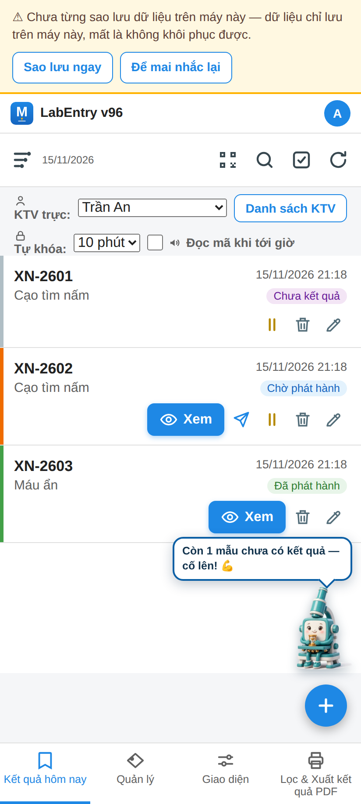

| 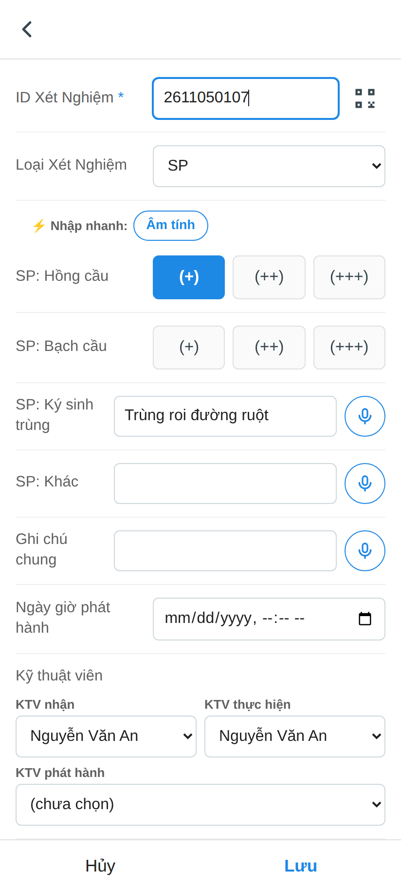 | 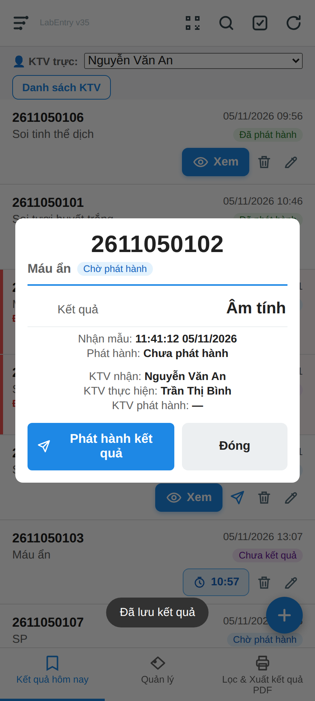 |
|---|---|
| 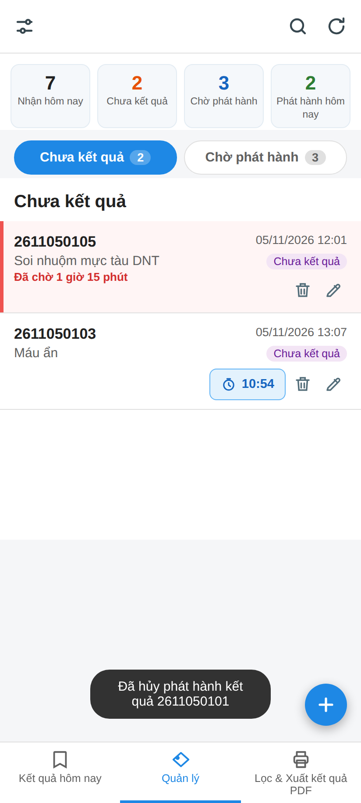 | 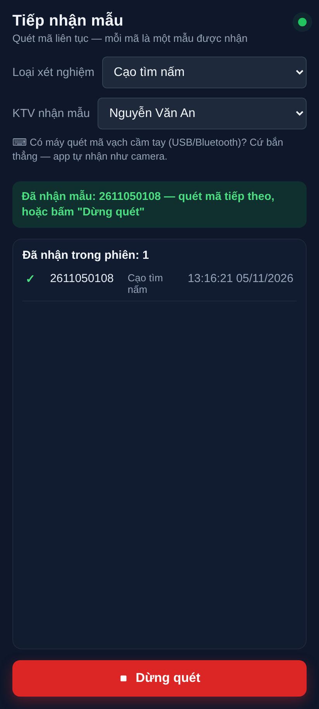 |
| 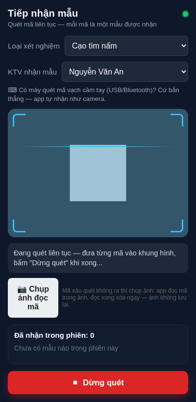 | 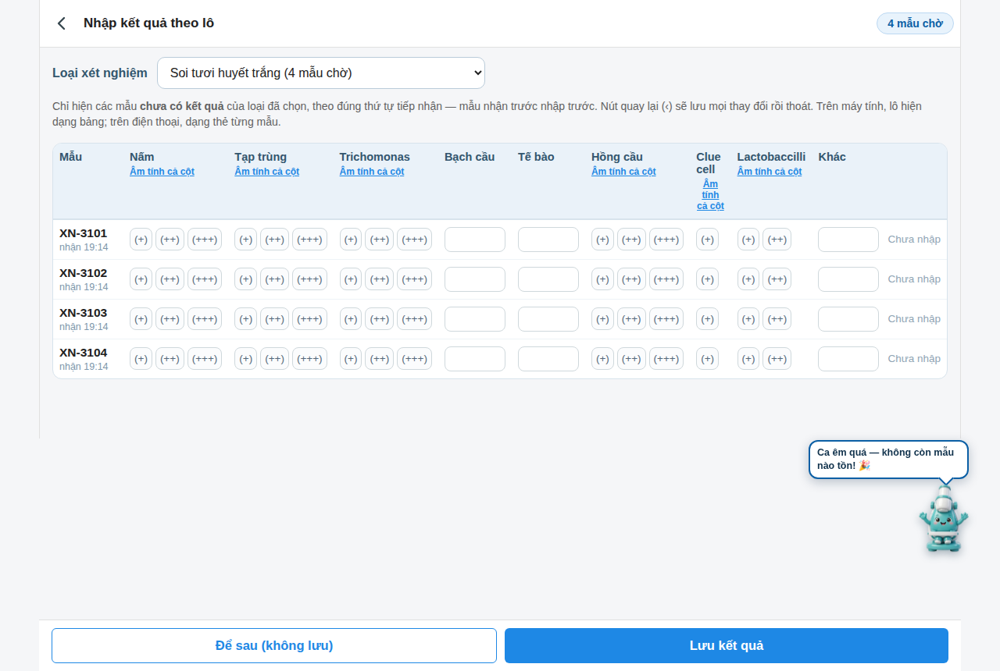 |
| 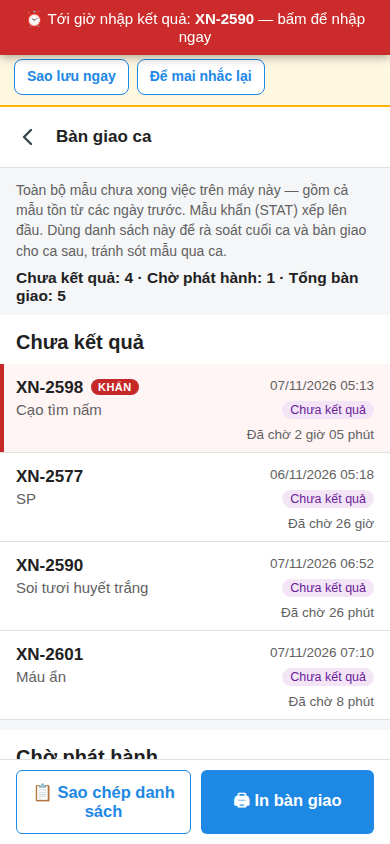 | 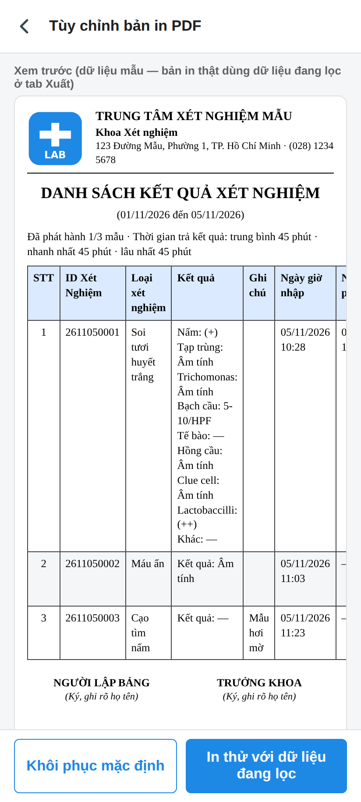 |
| 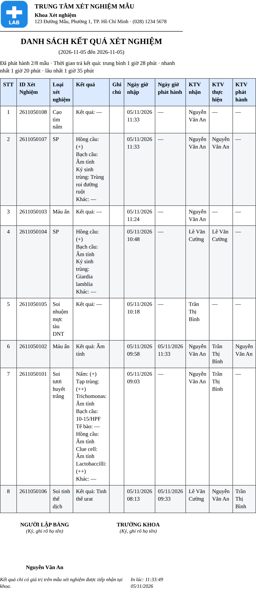 | 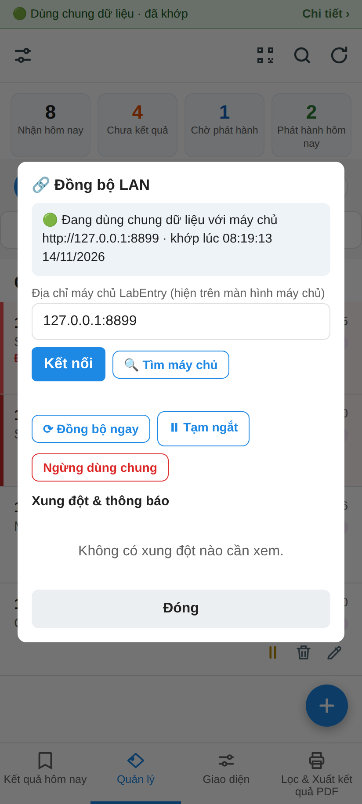 |

## Tính năng chính / Key features

- **Tiếp nhận mẫu bằng mã vạch** — quét liên tục bằng camera, chụp ảnh đọc mã in trên nhãn (OCR ngay trên máy), máy quét cầm tay kiểu bàn phím, hoặc nhập tay. Chặn trùng mã + loại xét nghiệm; cùng một mã vẫn nhận được ở nhiều loại khác nhau. · *Barcode intake — continuous camera scanning, on-device OCR of printed labels, wedge scanners, or manual entry. Same code + same test type is blocked; the same code under different types is fine.*
- **Ba trạng thái rõ ràng** — Chưa kết quả / Chờ phát hành / Đã phát hành. Mẫu chờ quá 60 phút tự tô đỏ; xét nghiệm hẹn giờ có đồng hồ đếm ngược từng mẫu và **báo động tới giờ nhập kết quả** (lặp lại mỗi 15 giây, banner đỏ, thông báo hệ thống, nút tạo nhắc qua Lịch). Phát hành ngay, hủy phát hành được khi cần sửa. · *Three clear statuses, overdue highlighting, per-sample countdown timers with a repeating due-time alert and calendar-reminder export. Instant release, undoable.*
- **Nhập kết quả nhanh** — trường nhập theo từng loại xét nghiệm, nút nhập nhanh một chạm, nhập bằng giọng nói tiếng Việt, và **nhập theo lô** cho nhiều mẫu cùng loại theo đúng thứ tự tiếp nhận. Ba loại khám sức khỏe (nước tiểu, máu SH-MD, ống CTM) chỉ cần đánh dấu "Đã có KQ" cho từng mẫu. · *Fast entry — per-test dynamic fields, one-tap quick results, Vietnamese voice input, and batch entry in strict intake order. The three health-check categories (urine, biochemistry, hematology tubes) need only a "result ready" tick per sample.*
- **Kỹ thuật viên & bảo vệ** — đóng dấu người nhận / thực hiện / phát hành theo KTV trực, mỗi KTV có mã PIN riêng; chưa đăng nhập KTV thì không nhập, không phát hành, không xóa được. Nhật ký thao tác ghi lại mọi thay đổi quan trọng. · *Technician stamps (receiver / performer / releaser) with per-technician PINs; intake, release and deletion are blocked until a technician is signed in. A built-in audit log records every important change.*
- **Mẫu hẹn lại & mẫu từ chối** — mẫu thiếu / không đạt / hẹn lại rời khỏi hàng chờ sang danh sách riêng, có trang bàn giao và in danh sách riêng; mẫu từ chối là loại hẳn nhưng vẫn lưu danh sách để tra cứu. · *Deferred and rejected samples leave the work queues for their own lists, with dedicated handover views and printable sheets.*
- **In ấn tùy biến hoàn toàn** — logo, đầu trang, cột bảng, khối chữ ký (kèm ảnh chữ ký KTV), khổ A4/A5, mẫu lưu sẵn; có kiểu **Sổ theo dõi** đúng khung sổ giấy BM04. Mọi tùy chọn áp dụng cho mọi kiểu phiếu. · *Fully customizable printing — logo, headers, columns, signature blocks with technician signature images, A4/A5, saved presets, plus a BM04-style tracking-ledger layout. Every option applies to every print style.*
- **Sao lưu & xuất dữ liệu** — sao lưu / phục hồi / gộp dữ liệu bằng file JSON, xuất CSV và thống kê thời gian trả kết quả (TAT). · *JSON backup / restore / merge, CSV export and turnaround-time (TAT) statistics.*
- **Đồng bộ LAN** — một máy chủ nội bộ giữ một bộ dữ liệu chung cho mọi máy trong phòng; mất mạng vẫn làm việc ngoại tuyến, có mạng tự khớp, chống trùng và bảo vệ mẫu đã phát hành. Xem [hướng dẫn đồng bộ LAN](docs/HUONG-DAN-DONG-BO-LAN.md). · *LAN sync — one in-house server holds a single shared dataset for the whole lab; offline work keeps going and reconciles automatically, with duplicate protection and released-record safety. See the LAN guide in `docs/`.*
- **Chạy không cần mạng** — sau lần mở đầu tiên ứng dụng tự lưu trên thiết bị (PWA): mất mạng vẫn nhận mẫu, nhập và phát hành kết quả, in ấn bình thường; có mạng lại sẽ tự cập nhật bản mới. · *Fully offline after the first visit (PWA); updates arrive automatically when back online.*

## Bắt đầu nhanh / Quick start

1. Mở [bản web](https://nguyentruongcongminh.github.io/lab-entry-app/) trên điện thoại hoặc máy tính.
2. Tạo KTV đầu tiên và đặt mã PIN, chọn KTV trực.
3. Bấm **+** để tiếp nhận mẫu (quét mã hoặc nhập tay), nhập kết quả khi máy phân tích trả, rồi **Phát hành**.
4. In bảng kết quả hoặc sao lưu dữ liệu ở tab **Lọc & Xuất PDF**.

*Open the web version, create the first technician with a PIN, receive samples with the + button, enter results, release, and print or back up from the Filter & Export tab.*

**Cài như ứng dụng:** mở bản web trong Chrome, bấm menu **⋮** → **"Cài ứng dụng"** (hoặc "Thêm vào màn hình chính") — biểu tượng LabEntry xuất hiện trên màn hình chính và chạy toàn màn hình. · *Install as an app: open the web version in Chrome, tap ⋮ → "Install app" (or "Add to Home screen").*

## Dữ liệu & riêng tư / Data & privacy

Mặc định toàn bộ dữ liệu nằm trong bộ nhớ trình duyệt **trên chính thiết bị đang dùng** — không gửi đi đâu, mỗi thiết bị một bộ dữ liệu riêng. Nếu phòng bật máy chủ LAN, dữ liệu dùng chung nằm trên **một máy trong phòng**, chỉ nhận kết nối nội bộ — vẫn không ra Internet. Hãy sao lưu định kỳ và giữ file sao lưu ở nơi an toàn. · *All data lives in the browser storage of the device itself — nothing is sent anywhere. With LAN sync, the shared dataset stays on one in-house machine, local connections only. Back up regularly and keep backup files safe.*

## Giấy phép / License

[MIT](LICENSE) © 2026 Truong Cong-Minh Nguyen
